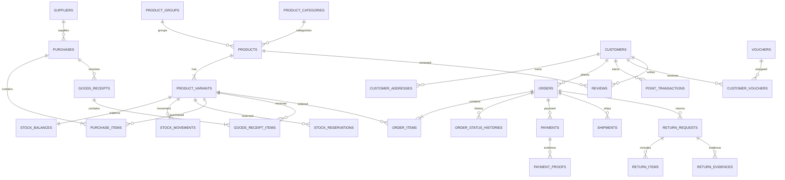

# ERD Konseptual — Unnie Vie Store

**Versi:** 0.1  
**Status:** Konseptual, perlu validasi sebelum migration

Diagram berikut menunjukkan relasi inti, bukan seluruh kolom atau seluruh tabel pendukung.

## Catatan
- ERD ini sengaja berfokus pada hubungan domain inti.
- `stock_reservations` terpisah dari `stock_movements` karena alokasi bukan pergerakan fisik.
- Order item menyimpan snapshot produk/varian/harga/HPP untuk menjaga histori.
- Alamat pengiriman order harus disimpan sebagai snapshot pada order.
- Implementasi final perlu menambahkan relasi akun admin, role/permission, cart, wishlist, voucher redemption, shipment history, CMS, notification, activity log, dan backup log.
- Semua foreign key, unique constraint, nullable rule, cascade behavior, dan index harus ditentukan pada desain migration.
