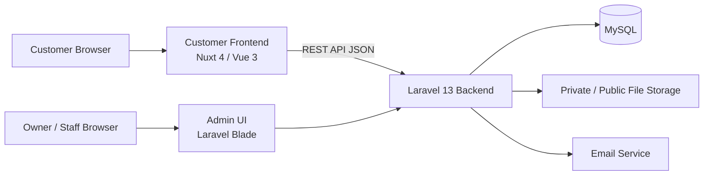

# System Architecture — Unnie Vie Store

**Versi:** 0.1  
**Status:** Draft rancangan teknis  
**Tanggal:** 14 November 2026

## 1. Arsitektur tingkat tinggi

Sistem menggunakan arsitektur hybrid dengan frontend pelanggan terpisah, backend Laravel sebagai pusat aturan bisnis, dashboard admin pada Laravel, dan MySQL sebagai database utama.

## 2. Komponen dan teknologi

### Backend dan admin
- Laravel 13 dan PHP 8.5.
- Admin dashboard menggunakan Blade dan Tailwind CSS.
- Menyediakan REST API JSON untuk frontend pelanggan.
- Menjalankan validasi, autentikasi, otorisasi, perhitungan, transaksi, dan aturan bisnis.
- Menjadi sumber kebenaran untuk harga, stok, status pesanan, dan permission.

### Frontend pelanggan
- Rekomendasi teknis: Nuxt 4, Vue 3, TypeScript, Tailwind CSS, dan SSR.
- Ini merupakan keputusan teknis perencanaan yang ditetapkan untuk mempercepat pemilihan stack; Project Overview tetap dipertahankan dengan pernyataan teknologi frontend belum ditentukan.
- Frontend tidak boleh mengakses MySQL secara langsung.
- Semua data dan operasi bisnis diperoleh melalui REST API.

### Database dan penyimpanan
- MySQL, InnoDB, `utf8mb4`, collation `utf8mb4_unicode_ci`.
- File bukti pembayaran dan video retur disimpan pada private storage.
- Foto katalog dapat menggunakan storage yang disajikan secara publik melalui mekanisme aplikasi yang aman.

## 3. Batas kepercayaan dan keamanan
- Semua input divalidasi backend.
- Semua aksi sensitif memeriksa authorization di backend.
- Gunakan HTTPS di production.
- Pisahkan konfigurasi development, staging, dan production.
- Rahasia aplikasi disimpan pada environment variables dan tidak masuk Git.
- Password tidak dicatat ke Activity Log.
- File bukti privat tidak boleh diakses melalui URL publik tanpa otorisasi.

## 4. Autentikasi
- Customer authentication terpisah dari admin/staff authentication.
- Customer login menggunakan email atau WhatsApp dan password.
- Admin/staff login melalui area admin.
- Pemilik memiliki akses penuh; staf menggunakan role dan permission.
- Mekanisme autentikasi API harus dipilih dan didokumentasikan sebelum integrasi frontend.

## 5. Integrasi dan kontrak API
- Format API JSON konsisten.
- Kontrak endpoint, payload, response, error, pagination, dan autentikasi harus disepakati sebelum frontend/backend diintegrasikan.
- Frontend tidak menghitung ulang aturan bisnis sebagai sumber kebenaran.
- Perubahan kontrak API harus dikomunikasikan dan ditinjau melalui Pull Request.

## 6. Pekerjaan tim dan Git
- Developer 1: backend, database, admin dashboard, dan API.
- Developer 2: customer frontend.
- Satu private GitHub repository.
- Gunakan feature branch dan Pull Request; hindari commit langsung ke `main`.
- Integrasi dilakukan setelah kontrak API disepakati.

## 7. Keputusan yang perlu ADR/validasi teknis
- Mekanisme token/session untuk customer API.
- Strategi CORS dan domain deployment.
- Package RBAC yang dipilih setelah audit dependency.
- Strategi queue dan scheduler untuk timeout order, notifikasi, dan backup.
- Penyedia email dan storage production.
- Strategi deployment Nuxt dan Laravel.
